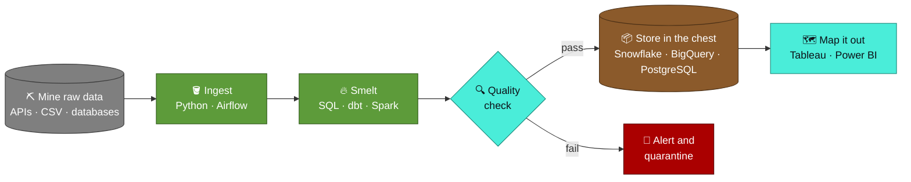
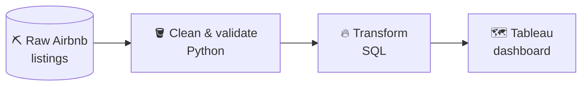
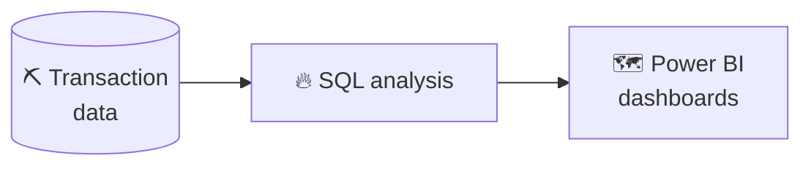
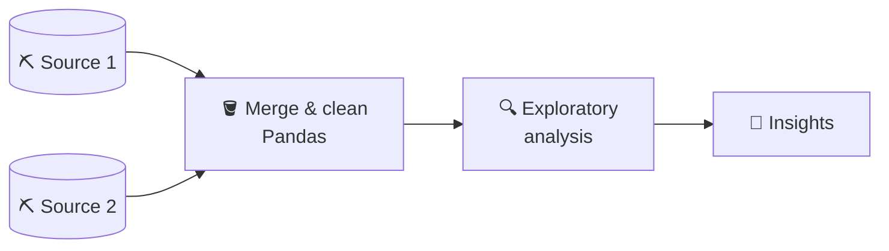

 

**🟩 [Player](#player-profile) · ⛏️ [Recipe](#crafting-recipe-a-data-pipeline) · 🎒 [Inventory](#inventory) · 🏠 [Builds](#builds) · 🏆 [Achievements](#achievements) · 📜 [Contact](#join-my-server)**

## Player Profile

I'm a Data Engineer who builds reliable, well-tested data pipelines. My work covers the full path from raw source data to analytics-ready datasets: ingestion, transformation, warehouse modelling, and the dashboards that business teams use to make decisions.

| | |
|:---|:---|
| 🧑‍💻 **Class** | Data Engineer |
| 🌍 **Home biome** | ETL/ELT pipelines, data warehousing, data quality, workflow automation |
| 🎯 **Looking for** | Data Engineering roles and collaboration on data projects |

<b>📜 Active quests</b>: what I'm learning (click to expand)

 

| Quest | Progress |
|:---|:---|
| Advanced dbt and Snowflake patterns | 🟩🟩🟩🟩🟩🟩⬜⬜ In progress |
| Apache Spark performance tuning | 🟩🟩🟩🟩⬜⬜⬜⬜ In progress |
| Kafka and real-time streaming | ⬜⬜⬜⬜⬜⬜⬜⬜ Up next |
| Cloud-native ETL (AWS Glue, Google Dataflow) | ⬜⬜⬜⬜⬜⬜⬜⬜ Up next |

## Crafting Recipe: A Data Pipeline

## Inventory

| Slot | Items |
|:---|:---|
| ⛏️ **Tools** (languages & processing) |     |
| 🔴 **Redstone** (orchestration & transformation) |   |
| 📦 **Chests** (databases & warehouses) |     |
| 🗺️ **Maps** (BI & visualization) |   |

## Builds

| Build | Language | Stars | Last updated |
|:---|:---|:---|:---|
| 🏠 [**Airbnb Data Pipeline**](https://github.com/gaurav190901/AirBNB) |  |  |  |
| 💳 [**Credit Card Transaction Analysis**](https://github.com/gaurav190901/Credit-Card-Transaction-Analysis) |  |  |  |
| 🏘️ [**Real Estate EDA**](https://github.com/gaurav190901/Real-Estate-EDA) |  |  |  |

*Click a build below to see how it was crafted.*

<b>🏠 Airbnb Data Pipeline</b> · Python, SQL, Tableau

 

Batch ETL pipeline that cleans and transforms 48K+ Airbnb listings into an analytics-ready dataset, visualized in Tableau.

[View repository →](https://github.com/gaurav190901/AirBNB)

<b>💳 Credit Card Transaction Analysis</b> · SQL, Power BI

 

Multi-dimensional analysis of credit card transactions using SQL, with interactive Power BI dashboards.

[View repository →](https://github.com/gaurav190901/Credit-Card-Transaction-Analysis)

<b>🏘️ Real Estate EDA</b> · Python, Pandas

 

Exploratory data analysis that combines multiple real estate data sources into a clear insight layer.

[View repository →](https://github.com/gaurav190901/Real-Estate-EDA)

## Achievements

  

  

<picture>
  <source media="(prefers-color-scheme: dark)" srcset="https://raw.githubusercontent.com/gaurav190901/gaurav190901/output/github-snake-dark.svg"/>
  <source media="(prefers-color-scheme: light)" srcset="https://raw.githubusercontent.com/gaurav190901/gaurav190901/output/github-snake.svg"/>
  
</picture>

## Join My Server

I'm always happy to talk about data engineering, pipeline architecture, or new opportunities.

