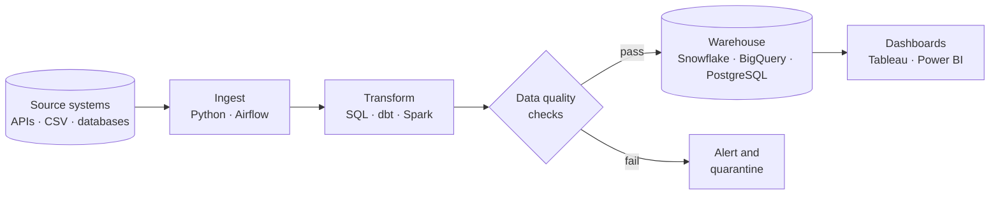
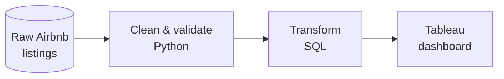
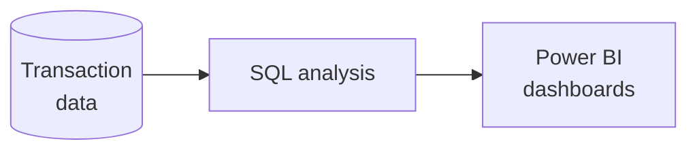
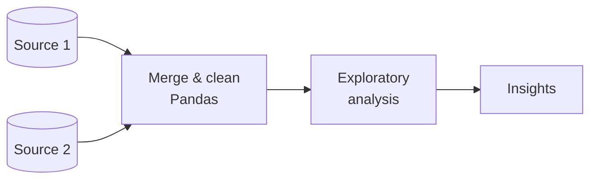

 

**[About](#about-me) · [How I Build](#how-i-build-pipelines) · [Tech Stack](#tech-stack) · [Projects](#featured-projects) · [Activity](#github-activity) · [Contact](#get-in-touch)**

## About Me

I'm a Data Engineer who builds reliable, well-tested data pipelines. My work covers the full path from raw source data to analytics-ready datasets: ingestion, transformation, warehouse modelling, and the dashboards that business teams use to make decisions.

- **Focus areas:** ETL/ELT pipeline design, data warehousing, data quality, and workflow automation
- **Open to:** Data Engineering roles and collaboration on data projects

<b>What I'm learning right now</b> (click to expand)

 

| Topic | Status |
|:---|:---|
| Advanced dbt and Snowflake patterns | In progress |
| Apache Spark performance tuning | In progress |
| Kafka and real-time streaming | Up next |
| Cloud-native ETL (AWS Glue, Google Dataflow) | Up next |

## How I Build Pipelines

## Tech Stack

| Area | Tools |
|:---|:---|
| **Languages & Processing** |     |
| **Orchestration & Transformation** |   |
| **Databases & Warehouses** |     |
| **BI & Visualization** |   |

## Featured Projects

| Project | Language | Stars | Last updated |
|:---|:---|:---|:---|
| [**Airbnb Data Pipeline**](https://github.com/gaurav190901/AirBNB) |  |  |  |
| [**Credit Card Transaction Analysis**](https://github.com/gaurav190901/Credit-Card-Transaction-Analysis) |  |  |  |
| [**Real Estate EDA**](https://github.com/gaurav190901/Real-Estate-EDA) |  |  |  |

*Click a project below for details.*

<b>Airbnb Data Pipeline</b> · Python, SQL, Tableau

 

Batch ETL pipeline that cleans and transforms 48K+ Airbnb listings into an analytics-ready dataset, visualized in Tableau.

[View repository →](https://github.com/gaurav190901/AirBNB)

<b>Credit Card Transaction Analysis</b> · SQL, Power BI

 

Multi-dimensional analysis of credit card transactions using SQL, with interactive Power BI dashboards.

[View repository →](https://github.com/gaurav190901/Credit-Card-Transaction-Analysis)

<b>Real Estate EDA</b> · Python, Pandas

 

Exploratory data analysis that combines multiple real estate data sources into a clear insight layer.

[View repository →](https://github.com/gaurav190901/Real-Estate-EDA)

## GitHub Activity

  

  

<picture>
  <source media="(prefers-color-scheme: dark)" srcset="https://raw.githubusercontent.com/gaurav190901/gaurav190901/output/github-snake-dark.svg"/>
  <source media="(prefers-color-scheme: light)" srcset="https://raw.githubusercontent.com/gaurav190901/gaurav190901/output/github-snake.svg"/>
  
</picture>

## Get in Touch

I'm always happy to talk about data engineering, pipeline architecture, or new opportunities.

